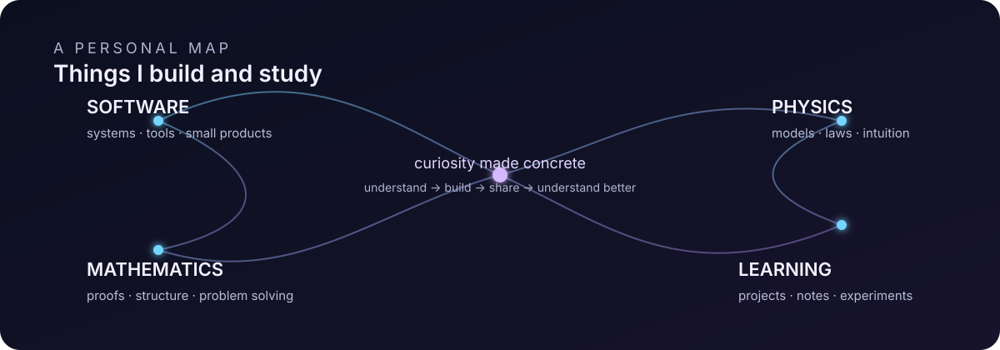

# Alejandro Mascort

> Software engineer interested in the structures behind things: reliable systems, mathematical proofs and physical models.

## What I build

I work mostly on backend systems and developer tooling. I enjoy the parts of software where the interesting questions are about **state, boundaries, failure, composition and clarity** — and I prefer small, focused projects where the idea remains visible in the implementation.

- [**multigrep**](https://github.com/alejandromc23/multigrep) — Recursive search and regular-expression queries over UTF-8 files, written in Rust.
- [**nvim.kickstart**](https://github.com/alejandromc23/nvim.kickstart) — A Neovim configuration shaped as a complete development environment.
- [**dotfiles**](https://github.com/alejandromc23/dotfiles) — Linux configuration and reproducible workstation setup.
- [**Axiom**](https://axiommath.app/) — Short daily mental-math puzzles.
- [**Aprofy**](https://aprofy.app/) — A study planner built around deliberate practice.
- [**Puttsy**](https://puttsy.app/) — Golf data turned into personal trends.

## What I study

Mathematics and physics are not just subjects I list; they are ways of thinking that I actively try to practice. **TheoremVault** is where I collect that work: definitions, proofs, theory and exercises, with room for the gaps between knowing a result and understanding it.

- [**TheoremVault**](https://theoremvault.xyz/) — Notes and exercises in mathematics and physics.
- [**SICP**](https://github.com/alejandromc23/SICP) — Working through *Structure and Interpretation of Computer Programs*.
- [**practice-rust**](https://github.com/alejandromc23/practice-rust) — Data structures and algorithms as a way to learn the language and its model.
- [**C programming language**](https://github.com/alejandromc23/c-programming-language) — Exercises and experiments based on K&R.
- [**Forecasting methods comparison**](https://upcommons.upc.edu/bitstream/handle/2117/167732/tfg-memoria.pdf?sequence=1&isAllowed=y) — My industrial-engineering thesis on prediction methods.

## The common thread

I like learning by moving between abstraction and implementation: formalize an idea, build something with it, inspect where the model breaks, and write down what was learned. This profile is a selection of things I have actually built or studied; the rest is in progress.

[Website](https://amascort.io/) · [TheoremVault](https://theoremvault.xyz/) · [GitHub](https://github.com/alejandromc23/)